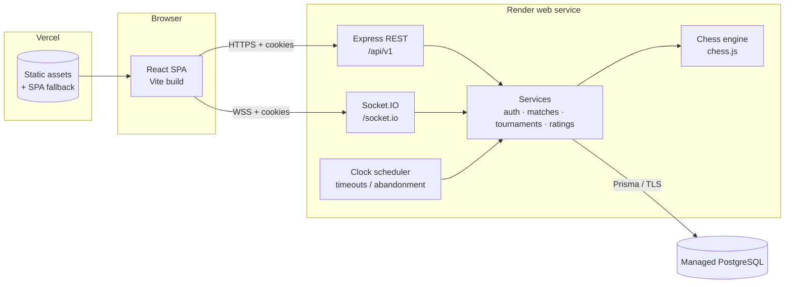
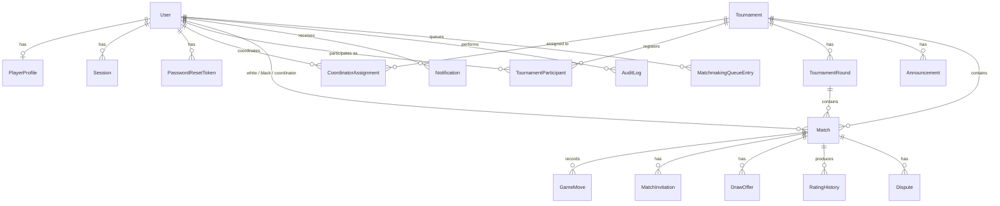

# ChessArena — Architecture

## 1. Overview

ChessArena is a monorepo with two deployable units:

| Unit | Tech | Hosting |
|---|---|---|
| `client/` | React 19, Vite 7, TypeScript 5.9, Tailwind 4, React Router 7, Socket.IO client, chess.js, react-chessboard 5 | Vercel (static SPA) |
| `server/` | Node.js, Express 5, TypeScript 5.9, Socket.IO 4.8, chess.js, Prisma 6, Zod 4, bcryptjs, jsonwebtoken, pino | Render web service (single instance for MVP) |
| Database | PostgreSQL 16 | Render PostgreSQL / any managed Postgres |

Key decisions:

* **Server-authoritative chess.** Every move is validated by `chess.js` on the server against the
  persisted FEN, inside a database transaction guarded by `positionVersion` (optimistic concurrency).
  The client renders state and proposes moves; it never decides outcomes.
* **Single source of truth = PostgreSQL.** Active game state (FEN, PGN, clocks, `turnStartedAt`,
  `positionVersion`) is persisted after every move, so a server restart loses nothing. In-memory data
  is only a cache (timeout timers, socket presence) and is rebuilt on boot.
* **Cookie sessions with JWT.** Login issues a short-lived access JWT (15 min) and a long-lived
  opaque refresh token (7 days, stored hashed in `Session`). Both are `HttpOnly` cookies.
  Logout / suspension revokes the session row, so refresh fails immediately and access tokens expire
  within 15 minutes; sockets re-check the session on connect and on every privileged event.
* **CSRF.** Double-submit token: a non-HttpOnly `csrf_token` cookie must be echoed in the
  `X-CSRF-Token` header for every state-changing HTTP request. Combined with `SameSite` cookies and a
  strict CORS allow-list.
* **One business layer, two transports.** HTTP controllers and Socket.IO handlers both call the same
  services (`MatchService`, `TournamentService`, …). The chess rules live in a pure module
  (`modules/chess/engine.ts`) with no Express/Socket.IO imports, so it is unit tested in isolation.
* **Centralized authorization.** `policies/` contains role checks (`requireRole`) and resource
  policies (`canViewMatch`, `canManageTournament`, …) used by both transports.

## 2. System diagram

Authentication path: `POST /auth/login` → `Set-Cookie: ca_access, ca_refresh, csrf_token` →
subsequent REST calls send cookies (`withCredentials`) and the CSRF header → Socket.IO handshake
sends the same cookies; the server verifies the access JWT, the session row and the `Origin` header
before accepting the connection.

## 3. Role-permission matrix

| Capability | Admin | Coordinator | Player |
|---|---|---|---|
| Global dashboard (`/admin/overview`) | ✅ | ❌ | ❌ |
| Manage accounts, roles, status | ✅ (cannot demote/suspend last active admin or self) | ❌ | ❌ |
| Create coordinators | ✅ | ❌ | ❌ |
| System settings | ✅ | ❌ | ❌ |
| Create tournaments | ✅ | ❌ | ❌ |
| Edit / transition tournaments | ✅ any | ✅ assigned only | ❌ |
| Register for tournaments | ❌ | ❌ | ✅ self |
| Register / remove participants | ✅ | ✅ assigned, before start | ❌ |
| Generate pairings / rounds | ✅ | ✅ assigned | ❌ |
| Create matches | ✅ | ✅ (players eligible; tournament must be assigned) | ✅ challenges with self as a participant |
| View matches | ✅ all | ✅ matches they coordinate or in assigned tournaments | ✅ own + public completed |
| Spectate live games | ✅ read-only | ✅ assigned, read-only | ❌ (own games only) |
| Make moves / resign / draw | ❌ | ❌ | ✅ own games, own colour |
| Cancel match before start | ✅ (with reason) | ✅ assigned (with reason) | ✅ own unstarted challenge |
| Submit dispute | ❌ | ✅ (report) | ✅ own completed games |
| Resolve dispute | ✅ | ❌ (recommend via note) | ❌ |
| Audit logs | ✅ all | ✅ entries on their tournaments/matches | ✅ own actions (`/players/me/activity`) |
| Leaderboard | ✅ | ✅ | ✅ (also public) |

Admins and coordinators do **not** play. Only accounts with role `PLAYER` have a `PlayerProfile`,
and every move/resign/draw handler requires the actor to be the match's assigned white/black player.

## 4. Data model (ER)

See `server/prisma/schema.prisma` for every column, enum, index and constraint.

Deviations from the brief (documented):

* `PlayerProfile` stores only `rating` (+ `peakRating`). Games played / W / L / D are **computed** from
  completed `Match` rows to avoid a second editable source of truth. The rating itself is the output of
  the rating-history ledger and is only written inside the result-finalization transaction.
* `Session`, `PasswordResetToken`, `MatchmakingQueueEntry`, `Announcement`, `SystemSetting`
  models are added; `Match` also stores `rated`, `incrementMs`, `initialTimeMs`, `drawClaimable`
  hints and `abandonDeadline`.

## 5. Match state machine

```mermaid
stateDiagram-v2
  [*] --> CREATED: open challenge (no opponent yet)
  CREATED --> WAITING: opponent invited / accepted seat
  [*] --> WAITING: invitation or coordinator assignment
  WAITING --> READY: both participants confirmed
  READY --> IN_PROGRESS: first participant joins room after scheduledAt (clock starts on White's first move window)
  IN_PROGRESS --> COMPLETED: checkmate · resign · timeout · draw (agreement / claim / automatic)
  IN_PROGRESS --> ABANDONED: reconnection grace exceeded before any move by the absent side
  COMPLETED --> DISPUTED: dispute submitted
  DISPUTED --> COMPLETED: admin resolves (result may be corrected; audited)
  CREATED --> CANCELLED
  WAITING --> CANCELLED
  READY --> CANCELLED
```

Transitions are enforced by `modules/matches/lifecycle.ts` (`assertTransition(from, to)`).
Result finalization uses `UPDATE … WHERE status = 'IN_PROGRESS' AND positionVersion = $v` so it can
happen exactly once.

## 6. Clock model

* `whiteTimeRemainingMs`, `blackTimeRemainingMs`, `turnStartedAt` (wall clock, persisted) and
  `currentTurn` are stored on the match.
* On a move: `elapsed = now - turnStartedAt`; mover's remaining `-= elapsed`; if ≤ 0 → timeout
  (or draw if opponent has insufficient mating material); else `+= increment`; `turnStartedAt = now`.
* Elapsed time within a process uses `performance.now()` deltas anchored at the persisted timestamp
  so local clock jumps do not affect a running turn; after a restart, the persisted wall-clock
  timestamp is used.
* A per-match `setTimeout` fires at the current mover's deadline and calls `MatchService.checkTimeout`,
  which re-reads the DB and finalizes only if the deadline really passed. On boot, all `IN_PROGRESS`
  matches are rescheduled.
* Clocks start when the match enters `IN_PROGRESS`: White's clock runs from that moment.

## 7. Disconnect policy

* A socket disconnect never ends a game. The opponent receives `match:opponent:disconnected` with the
  grace deadline.
* Grace period: `RECONNECT_GRACE_MS` (default 60 s). Clocks keep running. If the disconnected
  player's flag falls first, timeout applies. If the grace expires while the absent player has not
  reconnected, the match is finalized as `ABANDONED` with the present player winning (rated), unless
  fewer than 2 plies were played, in which case it is `ABANDONED` with no result and unrated.

## 8. Rating policy (Elo)

* Initial rating 1200. K = 40 for < 30 rated games, K = 20 below 2400, K = 10 at/above 2400.
* `E = 1 / (1 + 10^((Rb - Ra)/400))`; `R' = round(R + K·(S − E))`, S ∈ {1, 0.5, 0}.
* Only `rated` matches with a decisive or drawn `COMPLETED` result update ratings; `CANCELLED` and
  no-result `ABANDONED` games never do. Rating updates happen inside the finalization transaction and
  are protected by a unique `(matchId, playerId)` constraint on `RatingHistory`.
* Dispute correction reverses the original rating deltas and applies new ones (audited).

## 9. Tournament formats

* **Round robin** — circle method (Berger tables); odd counts add a BYE (worth 1 point, configurable).
  Points: win 1, draw 0.5, loss 0 (configurable per tournament). Tie-breaks: points → Sonneborn–Berger
  → number of wins → head-to-head → seed.
* **Single elimination** — seeded bracket padded to the next power of two; top seeds receive byes.
  A player advances only when their match has a finalized decisive result. Drawn knockout games create
  an automatic re-match (armageddon not modelled) — documented limitation.

## 10. Security model (summary)

See `docs/SECURITY.md`.
